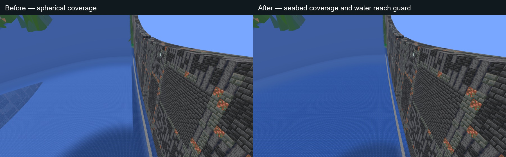
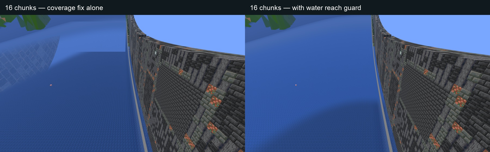

# Above-water seabed / Atlas handoff

This development follow-up starts from published 1.4 source, on top of main
`653b9b5`. It is not part of the already uploaded 1.4 JARs. It changes client
shaders, not generation, Atlas data, networking or server settings.

## Causes

An above-water camera can see distant Atlas walls and sky/void through deep
water near the real-terrain handoff. This is distinct from the submerged-camera
policy: hiding the Atlas while the camera is WATER does not address looking
through a water surface from air. There are two parts:

1. The altitude fix (#266) made coverage spherical:
   `sqrt(horizontalIntrinsicDistance² + canonicalHeightSeparation²)`.
   Native section traversal has independent horizontal and vertical limits.
   A seabed could be inside both limits but inside the spherical live fade.
   Its fragments were discarded while the water above was still transparent.
2. A ray enters the water nearer the camera than it reaches the floor. Even
   after correcting the premature fade, a transparent surface within range can
   reveal a deeper floor outside range. Surface-distance-only water opacity
   cannot close that gap. The 16-chunk follow-up capture isolated this case.

The Atlas describes exposed top surfaces, including water tops, not the seabed
underneath. Its local surface is also suppressed in the inner handoff region.
Consequently there is no replacement for a discarded or unloaded floor, and
the sky/Atlas pass shows through the transparent water.

For an eight-chunk view, live fading starts at 115.2 blocks. A floor 97.62 blocks
below the camera and 80 blocks away horizontally has spherical distance 126.2,
inside the live fade. The water's horizontal opacity fade has not even started
(it starts at 87.04 blocks). Both floor coordinates remain within native range.

## Changes

Live terrain and the Atlas use
`max(horizontalIntrinsicDistance, abs(canonicalHeightSeparation))`.
The deep floor in the example remains fully visible. A fragment outside either
range still hands off, retaining the high-altitude coverage fix. Zero-height
terrain coverage, periodic X distance, colours, lighting, detail distances,
fade windows, ordered live dithering and smooth proxy depth/alpha are unchanged.

Water has an additional conservative reach bound. For a camera above a water
fragment, the shader estimates how far its view ray could travel horizontally
before reaching the world's bottom. The floor bound comes from the existing
wall-top and configured-height uniforms; no sampled seabed or new binding is
needed. The existing opacity ramp uses the greater of ordinary coverage
and that reach. Rays entering nearby water can therefore close before exposing
a floor beyond live coverage. Close, steep downward views remain transparent;
shallower or more distant views become opaque sooner. Texture and colour
matching retain their original horizontal distance. A fragment above the
camera uses ordinary coverage. This is a safety bound, not measured water depth:
shallow pools can become opaque sooner too. The controlled screenshots make
this appearance change reviewable.

Both helpers live in the shared projection include. The ordinary 26.1/26.2
resources, 26.3 resources (including both OIT phases) and Sodium format adapter
consume the same policy. One additional scalar varying carries water reach;
GPU uniform layout, texture bindings and server formats are unchanged. Visual
profile version is eight. There is no new geometry or increased chunk range.
The submerged-camera Atlas skip and vanilla environmental fog remain intact.

This does not add exact underwater terrain to the Atlas or promise general
shader-pack support. It prevents transparency from revealing the absent far
floor in the controlled regression; the owner's exact server viewpoint has not
yet been visually confirmed with this development build. No FPS improvement is
claimed.

## Reproduction and fixture

`ringworld.captureDeepWaterHandoff=true` extends the existing muted underwater
fixture with a disposable 2,048 × 256 ring. A stone-bottom pool spans X480–800,
Z−120–120, Y0–63, with air cleared above it through Y128. The camera is at
X512.5 / eye Y97.62 / Z112.5, facing east, pitch 25 degrees, noon and no clouds.
`ringworld.underwaterViewDistance` selects eight by default or 16 for the owner's
reported 12–16 range. Six captures cover air, submersion, surface, resurfacing,
submerged resource reload and post-reload resurfacing, with fluid assertions.
Normal underwater-fixture scene inputs remain unchanged.

A named disposable `saves/Deep Water Handoff Review` copy can be reused. Normal
file-fix backup/completion handling is allowed, never downgrade or experimental
prompts. `ringworld.reuseDeepWaterScene=true` skips reconstruction only after
checking the copied stone floor, water and clear camera position. Original
worlds and the public demo are untouched.

The fixture now sets render distance before login and broadcasts a changed
option, so the native player chunk request agrees with the setting. Deep
captures wait for pool chunks along the east-facing view as well as a settled
compiler and complete Atlas. An empty compiler alone does not prove delivery.
The first 16-chunk attempt had changed the option after login without sending
client information; its chunk-shaped cutoffs are retained as failed visual
evidence, despite its completion marker. A later corrected capture isolated
the second, genuine ray-through-water problem described above.

## Validation

All six source build/test cells pass on Java 25: Fabric and NeoForge each run
516 Java cases on 26.1.2 and 26.2, and 519 on 26.3 (3,102 total, no failures,
errors or skips). The full Python suite passes 511 tests with four expected
Windows-only skips on this Mac. Final logs are under
`logs/deep-water-handoff/builds-opacity/` and `static-tests-opacity.log`.

Final native checks run on macOS, with all six fluid/reload captures and clean
exit for every representative game-family/loader pair:

| Game family | Fabric | NeoForge |
| --- | --- | --- |
| 26.1.2 (shared 26.1 ABI) | PASS | PASS |
| 26.2 | PASS | PASS |
| 26.3 | PASS | PASS |

The targeted 26.3 Fabric + Sodium 0.9.2 check also passes, including shader-adapter
activation and post-reload resurfacing. The final 16-chunk check also passes,
with requested/effective distance logged as 16/16. All eight runs produce six
captures each (48 final-source captures total), assert expected camera fluid,
finish resource reload and resurfacing, and exit cleanly. The final above-water
images were reviewed for retained water texture and absence of the exposed
distant wall/sky gap in this controlled scene.
Final results are in `native-opacity-results.json`; native logs and screenshots
are under `final-opacity/`, `sodium-opacity/` and `user-distance-16-final-source/`.

Earlier metric-only and coupled colour/opacity trials are separate. The final
policy advances only opacity, preserving the original horizontal colour match.
The initial scene timeout and invalid 16-chunk visual capture are retained.
An early unit expectation still assumed the old shader literal; it was corrected
and rechecked. Its first full build log was overwritten; the failure is recorded
in `builds/initial-failure-note.json`. An initial Python process-cleanup permission
error is retained in `static-tests.log`; isolated and full rechecks pass without
changing that unrelated harness.

Native development captures are not the full release suite: no Windows native,
multiplayer suite, full qualification or FPS benchmark was rerun. Published JARs
and the public demo remain unchanged. Owner visual acceptance is still pending.

## Comparison images

The first pair compares original spherical shader coverage with the final fix
at eight chunks. The second isolates the remaining 16-chunk water-ray problem:
coverage correction alone versus the complete fix. Labels are outside the native
images; scene/camera settings match, while water animation and entities may move.
The interactive gallery and SHA-256 manifest are retained under
`logs/deep-water-handoff/review/` locally; they link the full-resolution originals
in each run’s screenshot directory.

