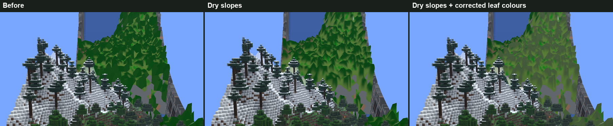

# Medium Atlas dry slopes

The Medium mesh now samples the terrain texture across steep dry faces where the upper sample has no captured side material. Each quad checks its full display-Atlas footprint, including the neighbouring texture samples and longitude wrap. Water coverage or a sand map colour keeps the previous upper-sample treatment. Captured rock faces keep their side material. Water and sand transitions participate in the mesh fingerprint so edits can change the sampling decision without changing terrain height. The trial changes the local client mesh and uses the existing Atlas format.

## Native comparison

NeoForge 26.3, seed 255, 2,048 × 128 ring, Medium, ten chunks. Four builds each followed the same five camera poses on fresh clones of the saved world. Each movement sample lasted 300 game ticks with capture off. The control, dry-slope and rock experiments matched the Atlas payload at each camera. The foliage experiment deliberately changed the sampled leaf colours in a separate copy of the world. All runs published 141,312 mesh vertices.

| Trial | Whole frames | p95 | p99 | Frames over 50 ms |
| --- | ---: | ---: | ---: | ---: |
| Main at 835af54 | 1,197 | 33.33 ms | 33.59 ms | 0 |
| Dry slopes | 1,244 | 33.33 ms | 33.34 ms | 0 |
| Dry slopes with neighbouring rock colours | 1,181 | 33.33 ms | 34.61 ms | 0 |
| Dry slopes with corrected spruce and birch tints | 1,237 | 33.33 ms | 34.62 ms | 0 |

These are single movement passes. A mesh probe compared all 32,768 terrain triangles. It found 10,027 with newly varying texture coordinates, including 780 in the snowy-ridge span. No vertex moved. All 3,214 triangles with explicit side material and all 9,688 triangles touching water or sand retained their original coordinates.

## Follow-up experiments

Blending nearby captured rock colours at triangle corners left the sampled side material dominant. The change was subtle in the snowy-ridge capture and did little for the forest.

Minecraft uses constant spruce and birch tints. RingWorld's dedicated-server sampler uses biome foliage colour for both and can fall back to the block map colour. Reading the actual saved top blocks and corresponding Atlas samples found 19,596 spruce and 29,601 birch columns, all stored as the same RGB value, 0x004000. The foliage trial used Minecraft's species tints and RingWorld's existing texture luminance. The disposable Atlas correction changed colours only. Height, water and light matched byte for byte before launching. Existing persistent Atlases store colour without the leaf species, so applying this to previously captured terrain would require resampling or rebuilding it. Neither follow-up experiment is part of the dry-slope change.

Local review gallery and native PNGs are in `logs/dry-slope/`.
