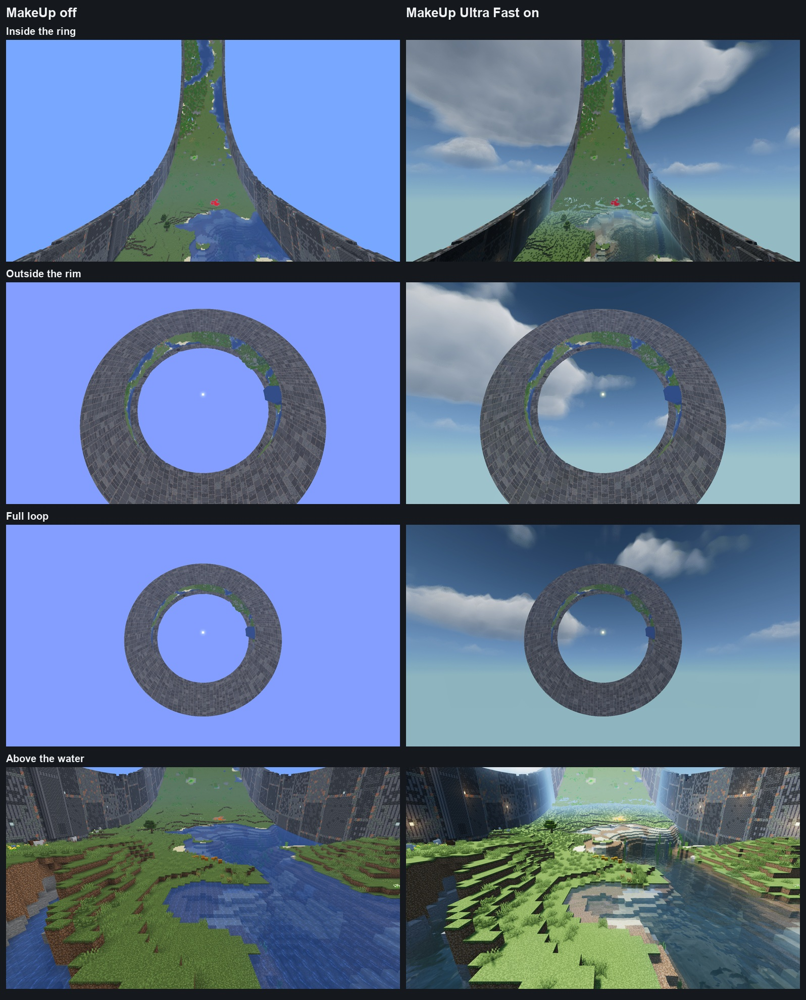
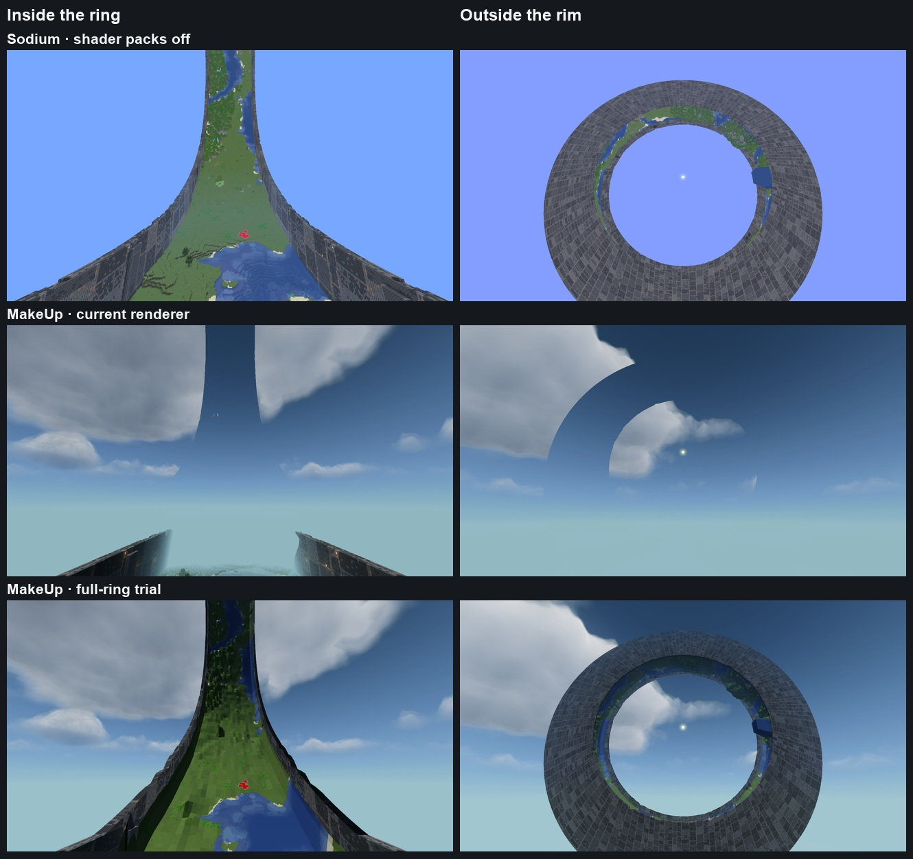
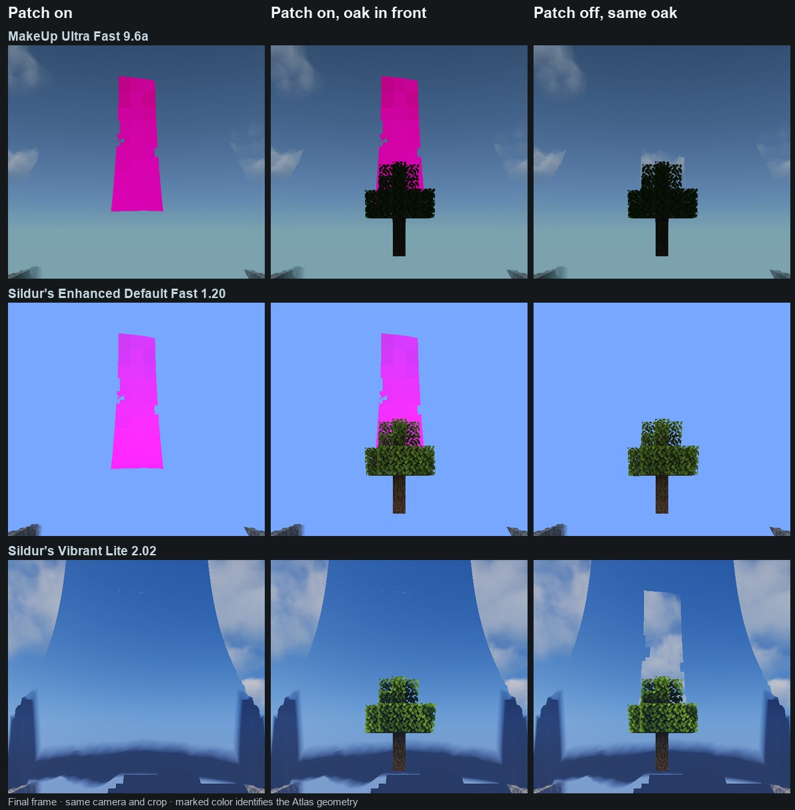

# Shader-pack rendering experiment

## Stock Atlas mesh and water through MakeUp

The optional `ringworld.nativeAtlasTrial=true` mode uses RingWorld’s normal GPU mesh, layer selections, mipmapped materials, industrial walls and depth-aware water backing. It redirects the Atlas draw into the active opaque block program’s first color output on Iris/OpenGL, keeping the original depth attachment. It restores the color attachment after the draw. The pack then runs its own deferred and final passes. The opt-in renderer does not build a second mesh or read the terrain texture back to the CPU. Normal live Minecraft water still uses its translucent rendering pass. The distant Atlas represents water with the sampled surface and backing; it does not simulate a distant translucent water volume.

The first native-mesh trial restored the far ring, but MakeUp's nearby chunk vertices still used flat positions. This left the distant bay apparently floating above the live water. Starting the Atlas earlier masked the gap when looking down from above, but the low shoreline camera exposed it. The retained version uses **the ordinary Atlas shader and its original fade and water-backing distances**. It applies the same RingWorld projection to the position decoded by Iris for opaque, cutout and translucent Sodium terrain, including their shadow passes. It supplies the current eye height and ring settings to those programs directly. An earlier attempt relying on the ordinary terrain uniform block lost live chunks and was discarded. No MakeUp shader files are edited.

The near pool still shows the submerged block steps. The distant lake uses the normal Atlas water sample. MakeUp's water reflectivity, fog, shadows and exposure differ from Minecraft's. A haze boundary remains visible along the distant sidewalls. The experiment has only been exercised with this completed 2,048 × 128 save and the 26.2 Iris/OpenGL ABI. Packs which assign a different meaning to the first opaque output or reconstruct depth differently require independent verification.

The earlier NeoForge check silently fell back to shaders off when the transformed Iris class could not open RingWorld’s projection include. The shared implementation now reads the include through Minecraft’s resource manager. The accepted runs check the six projected terrain and shadow programs, the active opaque color destination, matching camera coordinates, and the four presented screenshots.

Use the dual-loader proof jar with `patch.ringCompare=true`, `patch.shore=true`, and `ringworld.nativeAtlasTrial=true` for the four views. Use the same Iris/Sodium installation and disable shaders for the control. Disable the older full-scene test and leave the diagnostic footprint resource pack off.

### Matched frame times

Settled frame intervals on Apple M2, 180 frames per pose, Minecraft 26.2 at 12 chunks. Each entry is mean / p95 in milliseconds. Shader-off kept Iris and Sodium loaded. These were separate client launches and include frame pacing. They measure the whole scene, including the pack’s post-processing.

| Pose | Fabric, off | Fabric, MakeUp coarse trial | Fabric, MakeUp normal mesh | NeoForge, MakeUp normal mesh |
|---|---:|---:|---:|---:|
| Inside | 4.33 / 11.56 | 11.26 / 16.32 | 14.69 / 23.78 | 10.56 / 16.25 |
| Outside rim | 3.80 / 9.76 | 13.52 / 20.49 | 17.20 / 28.34 | 10.19 / 16.86 |
| Full loop | 2.78 / 7.60 | 10.89 / 16.70 | 15.97 / 25.43 | 10.56 / 18.53 |
| Waterline | 5.80 / 12.09 | 16.53 / 22.27 | 20.67 / 29.14 | 20.53 / 29.54 |

The Fabric motion sample across the wrap averaged 18.34 ms and peaked at 43.48 ms. The final Fabric log also flagged separate 18–20 ms surface resource updates. In a previous Fabric pass with the same stock shading and scene, mean waterline time was 15.45 ms. Treat the difference from the coarse renderer as a whole-client observation; the samples do not isolate GPU mesh cost.

## Earlier coarse-mesh experiment

This is a native rendering trial on the completed seed 259 ring in Minecraft 26.2. The same dual-loader add-on submits the actual Atlas terrain and both wall textures as opaque geometry through Iris. The public release still uses its original renderer.

All six frames use the same save, noon, clear weather, a 12-chunk view distance and the same camera per column. In the existing MakeUp interior the far side vanishes, leaving only nearby walls and a patch of sky where the ring should rise. The new path keeps the lake, red landmark and industrial rims in their corresponding positions. It also preserves the loop from the exterior. MakeUp supplies its own clouds and lighting.

The entire circumference is visible in the wider exterior views with [MakeUp Ultra Fast](makeup-full-ring.jpg) and [Sildur’s Enhanced Default Fast](enhanced-full-ring.jpg). Enhanced Default puts more haze on the distant interior.

The first full-scene attempt cut the proxy off at the nominal chunk radius. From inside the ring this left open sky between the local walls and distant surface. The revised trial overlaps the two: the Atlas approaches its surveyed elevation from up to 12 blocks below real terrain and extends to within three chunks of the camera at this setting. Real blocks can hide the overlap by depth. The separately tested foreground oak also hides the distant surface. This is a coarse 256 by 24 mesh and a frozen snapshot of a single test world. Faceted terrain, opaque water and differing wall lighting are visible limitations.

### RingWorld alone

We repeated the pre-experiment Fabric 26.2 route with RingWorld and its normal dependencies, with the same 51 loader modules and the same camera positions. Both runs published a 196,050-vertex terrain mesh and a 2,048 × 128 texture. Both rim views had over 99.9% exactly equal RGB pixels. The largest mean absolute channel difference was blue in the seam-join view, 0.146 on a 0–255 scale. The clean renderer retains its terrain detail, curvature and water. [Four matched views](ringworld-only-comparison.jpg)

### Whole-ring frame time

These are complete frame intervals on one Apple M2, with 180 frames per stationary pose. Mean and p95 appear in milliseconds. Comparing the first two rows measures the cost of making the missing ring visible under the same shader pack.

| Minecraft 26.2, 12 chunks | Inside mean / p95 | Exterior mean / p95 |
|---|---:|---:|
| Fabric, MakeUp, existing renderer | 13.81 / 20.80 | 14.10 / 21.92 |
| Fabric, MakeUp, whole-ring trial | 15.94 / 23.08 | 15.63 / 23.38 |
| NeoForge, MakeUp, same trial jar | 14.68 / 23.77 | 15.40 / 22.62 |
| Fabric, Enhanced Default Fast, whole-ring trial | 7.52 / 14.37 | 9.96 / 18.31 |
| Fabric, Sodium and Iris, shader packs off | 3.56 / 7.74 | 4.12 / 13.02 |

Full-ring rendering added about 2.13 ms inside and 1.53 ms outside in the matched MakeUp runs. These timings exclude startup and the initial texture copy. Larger rings and moving-camera whole-ring frame times remain unmeasured.

## The diagnostic strip

Minecraft 26.2, seed 259, a completed 2,048 × 128 ring, a 12-chunk view distance, and a camera at (2, 121.62, 0.5) looking west. The trial covers one 160 × 36 block patch across the wrap, between canonical X 1,680 and 1,840 and Z −18 and +18. It uses the sampled Atlas heights, the same nearby block correction as the full ring, and the ordinary physical depth of its vertices. The patch is roughly 205–345 blocks from the eye. Production jars exclude the experiment.

[See the same MakeUp camera with sampled Atlas terrain colours.](atlas-colour.jpg)

## Single-patch depth and occlusion results

With Iris 1.11.4 and Sodium 0.9.2, MakeUp Ultra Fast 9.6a and Sildur’s Enhanced Default Fast 1.20 preserved the marked geometry through the final pass. An ordinary oak generated with Minecraft’s oak feature at (2026, 120, 0) hid the patch. The fixture puts the oak on a single dirt block at camera height to intercept this particular sightline. The screenshots were taken with a stationary camera, first without the oak, then with the oak and the patch toggled in place. They are final shader-pack framebuffer captures.

In the MakeUp Fabric run, 23,347 previously unmarked pixels in the patch region turned magenta. With the oak in front, 15,157 stayed magenta. At 7,616 formerly magenta pixels, the final color matched dark oak in the patch-off control to within eight levels per RGB channel. At pixel (854, 310) the patch alone was (214, 3, 175), and the oak was (12, 14, 9) with the patch both on and off. With NeoForge and MakeUp the same test produced 23,347 marker pixels, with 15,093 remaining behind the oak and 7,601 matching the dark oak control. The Enhanced Default run also had 23,347 marker pixels without the oak and 15,006 still visible with it. Leaves, temporal filtering and swaying foliage can change individual edge pixels between frames.

Sildur’s Vibrant Lite 2.02 is the counterexample. Iris received 23,302 marked pixels in the pack’s albedo target, colortex4. The pack’s deferred pass reconstructed distance from depth and used the ordinary view range in its own fog calculation. At pixel (854, 250), the input albedo was (207, 4, 199), the deferred output was (52, 82, 139), and the presented pixel was sky blue (73, 127, 194). The final patch region contained zero marker pixels. A diagnostic that increased the range across the whole ring view recovered the marker but also changed ordinary terrain fog. That variant was discarded.

On the same Fabric client, with 600 measured frame intervals per condition across an off/on/on/off sequence, mean frame time for MakeUp was 15.59 ms without the strip and 15.31 ms with it. While strafing across the view it was 16.97 and 16.43 ms respectively. On NeoForge, stationary MakeUp measured 16.60 and 16.26 ms. Enhanced Default on Fabric measured 8.14 and 7.89 ms. None of these windows had a frame over 50 ms. Differences this small do not demonstrate a speedup. These figures cover only the diagnostic strip.

## How it works

* The shared client mixin submits one two-sided, 30-quad opaque material to Minecraft’s feature collector. Iris assigns the material its block program through its public API. The pack chooses the color attachments, lighting, and depth state. The geometry can be colored from the actual Atlas or marked magenta for comparison.
* The separate test resource pack gives the footprint a single depth owner. Without it, the sky Atlas can write a slightly different depth for the same area and cut holes in the patch. The resource pack is specific to this fixture and must be removed with the trial.
* A narrow Iris/OpenGL adapter supplies the ring's optical range only while drawing the private patch pipeline. It restores the program’s previous `far` value even if the draw throws. The camera, perspective, depth values, chunk distance and full-screen passes keep their normal settings. A full-screen pack effect can consequently still fog the patch away.
* The same Java implementation runs on Fabric and NeoForge. The experiment targets the 26.2 GPU API. Both loader descriptors are attached to one test jar. Production sky-view capture also needed a shared overload selector because NeoForge 26.2 keeps an older delegating sky-pass method alongside the one that schedules the draw.
* NeoForge’s development-only OpenGL validator failed in the Iris/Sodium shadow multi-draw. It indexed vertex binding slot 1 of a one-element array before the patch proof ran. The NeoForge visual and timing runs used its documented-in-source `neoforge.disableGlValidation=true` developer switch to match normal client behavior. The trial does not change the validator or the player’s settings.

## Repeat the experiment

1. Use the MC 26.2 development runtime and a disposable copy of the completed test save. Build RingWorld’s main and client classes first. Prepare a newline-delimited compiler classpath containing those outputs, the named 26.2 client, Iris 1.11.4, the NeoForge FML annotation, Mixin, MixinExtras, and the usual Minecraft runtime libraries.
2. Run `python3 experiments/opaque-atlas-patch/build_trial.py --classpath-file PATH --output OUT --proof` with Java 25 on PATH. The output is one dual-loader add-on and the test footprint resource pack. Install the add-on alongside RingWorld, the loader’s Iris/Sodium jars, and Fabric API when using Fabric. Enable the footprint resource pack **above** mod resources.
3. Run the existing muted visual parity capture against the disposable save at 12 chunks. Set `ringworld.patchMarker=true` for the marked view. The proof holds the seam-join camera, captures directly after Iris’s final pass and places the oak only in this test world. The output directory is `patch-proof` inside the test instance. `patch.attachments=true` also captures the scene buffers.
4. For timing, use a fresh copy, disable the marker and attachments, set `patch.perf=true`, turn VSync off, and use the same 260 FPS cap. The proof alternates off/on/on/off at the same pose, discards 90 warm-up frame intervals in each window and samples 300 intervals per window. `patch.strafe=true` moves the camera laterally through the patch view. The native logs record `PATCH_TIMING` and the actual Z range. These intervals measure frame time, including frame pacing, rather than GPU-only draw duration.

The full-scene fixture uses the completed Atlas and its wall strips. Enable both `patch.ringCompare=true` and `ringworld.fullSceneTrial=true`, and leave the footprint resource pack off. A paired control uses the same camera fixture with the full-scene flag off. It saves the interior and exterior screenshots to the normal screenshots directory, and logs mean and p95 frame intervals over 180 frames per pose after 75 settling ticks.

The trial freezes the color and heights once and draws water as an opaque surface. Live edits, normal Atlas handoff and blending, transparent water, shadow casting and secondary views still need qualification.
