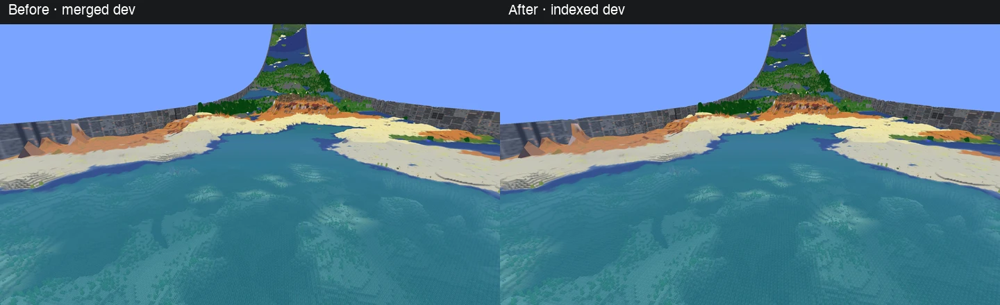

# Deep-water bay frame time

[Full-size before](before.webp) · [Full-size after](after.webp) · [Original seven-view comparison](../default-comparison/README.md)

The camera is at X 3361.5, Y 109, Z −27.5, yaw −100°, pitch 18°. Each build connected to its own dedicated server on a copy of the fully generated Large ring, seed 202610093. The client used NeoForge 26.3, Apple M2 OpenGL, 2560 × 1440, Medium Atlas detail, 12 chunks, clear noon, clouds off, HUD hidden, VSync off and an active client input timer. Dev used both layers at the default 2× band width. The control was published RingWorld 1.4.0, SHA-256 `c0cba972efd6ce9fa428372cb3e1569b81331533d538bac3302a9560321e5d01`. The unoptimized dev control was the build accepted in PR #320.

## Geometry and image checks

Both 1.4 and dev submit 6,979,584 base triangle vertices. Dev submits another 13,998 at this camera, 0.20% of the base count. The complete dev mesh, including off-camera layer ranges, contains 10,497,072 triangle vertices. Before this change, its 72 GPU pages occupied 251,929,728 bytes. The same mesh now uses 59,340,504 bytes of vertices and 20,994,144 bytes of indices, a 68.1% reduction in resident mesh bytes. These figures exclude textures, CPU staging memory and driver overhead.

The worker indexes vertices only when all 24 bytes of position, UV and colour agree. Triangle order, material tags, seam vertices and layer range endpoints survive indexing. A page that exceeds the 16-bit limit or would grow uses the original representation. Tests expand the index stream and check the original bytes, including across pages and through unsigned indices above 32,767.

The matched screenshots retain the bay floor, shoreline, water handoff and far wall. Water animation and entities advance between captures. In the original PNGs the mean absolute RGB difference was 1.04 levels out of 255 between builds, compared with 0.65 and 1.09 between different frames in the respective builds.

## How the timings were taken

The fixed-camera probe waited for the complete Atlas, ready mesh, loaded sections and five seconds at the correct position. Each run alternated draw modes in 150-frame blocks and discarded the first 20 frames of every block. Mode 0 drew the whole scene (650 measured frames per run). Mode 1 omitted the Atlas draw, leaving native terrain and resource updates active (260 frames). Mode 2 omitted the supplementary range in dev (260 frames). Mode 3 bracketed the Atlas draw with OpenGL finishes (260 frames). The last metric measures elapsed time for the isolated draw including submission and synchronization. Its time cannot be subtracted directly from pipelined whole-frame time.

The first sequence was release → merged dev → indexed dev. The repeat reversed that order. These are runs on one machine and driver. The two shader probes used temporary diagnostic jars based on merged dev. The indexed build retains the accepted shaders.

## Bay results

Median of each run in milliseconds. The p95 column covers normal rendering.

| Build | Whole frame A / B | Frame p95 A / B | Atlas draw A / B |
|---|---:|---:|---:|
| Published 1.4 | 16.23 / 18.01 | 25.29 / 27.86 | 5.07 / 6.18 |
| Merged dev | 25.12 / 19.09 | 33.62 / 29.33 | 7.47 / 6.92 |
| Indexed dev | 16.23 / 15.03 | 21.30 / 21.74 | 3.19 / 3.53 |

Suppressing only the supplementary range on merged dev gave whole-frame medians of 23.34 and 16.78 ms. Full Atlas draw cost fell by 3.38–4.28 ms after indexing. The base mesh already repeated shared vertices in 1.4. These tests establish where time can be recovered; varying whole-frame results also include native chunk rendering, background work and driver scheduling.

## Water diagnostics

Each run changes one shader on otherwise unmodified #320. The release-water probe restores the 1.4 native water tint and alpha calculation. The backing probe removes the Atlas depth backing behind transparent native water.

| Diagnostic build | Whole frame | Whole frame with Atlas draw omitted | Isolated Atlas draw |
|---|---:|---:|---:|
| Release native water shading | 16.64 | 11.23 | 6.22 |
| Water backing disabled | 19.05 | 16.84 | 6.66 |

## Replay of the original route

Matched camera poses, 150 frames per pose after settling. The first two columns are the original published and merged-dev captures from the linked comparison. The indexed replay used the final candidate and a fully populated warm dev Atlas. These single-run route samples include scene transitions and can differ from the stationary tests.

| Scene | 1.4 median | Merged dev median | Indexed median | Indexed p95 |
|---|---:|---:|---:|---:|
| Jungle canopy | 14.41 | 20.08 | 13.26 | 20.07 |
| Spruce forest | 16.19 | 23.14 | 16.52 | 25.75 |
| Deep-water bay | 14.55 | 24.72 | 17.14 | 28.45 |
| Shallow reef | 19.99 | 19.88 | 15.90 | 23.31 |
| Wrap seam | 16.09 | 13.05 | 9.77 | 21.28 |
| Outer rim | 16.72 | 16.50 | 10.99 | 17.93 |
| Far arc | 9.67 | 11.47 | 7.09 | 16.41 |

[Per-run statistics](measurements.json) · [Individual fixed-camera frame samples](frames.csv.gz) · [Indexed camera route samples](route-frames.csv.gz)

Restoring the release's native water shading reduced frame time even with the Atlas draw omitted (11.23 ms versus 15.67–16.85 ms). This implicates live water matching as part of the bay cost. Removing just the Atlas depth backing left the isolated draw at 6.66 ms, close to the unmodified 6.92–7.47 ms. These single-run shader probes cannot assign an exact exclusive cost to either operation. Neither visual compromise is part of the fix.

The main tradeoff is CPU work when a replacement mesh is built. In a separate worker-side benchmark, indexing a fully populated Large-ring mesh took 110–179 ms across four passes, excluding triangle emission. The previous mesh stays visible during the build. The native geometry and shader inputs are identical in the two indexed candidates. The final candidate sizes scratch arrays to fit small meshes.

The complete seven-view replay had a median of 14.31 ms, compared with 19.00 ms for merged dev and 15.75 ms for published 1.4. In the bay on arrival, indexing recovered 7.58 ms of the 10.17 ms gap. All five supported 26.x game versions passed Fabric and NeoForge builds and tests, and all 14 source-parity checks passed. Native frame and image validation used NeoForge 26.3.

A final shader experiment skipped native water matching and ordered coverage inside the distance where both blends are zero. On the same route, the bay median was 17.22 ms with that branch versus 17.14 ms without it. The seven-view median was 14.39 versus 14.31 ms. The shader experiment was discarded.

[Spruce-to-bay replay after the spare Atlas texture expires](sparse-edits.md)
